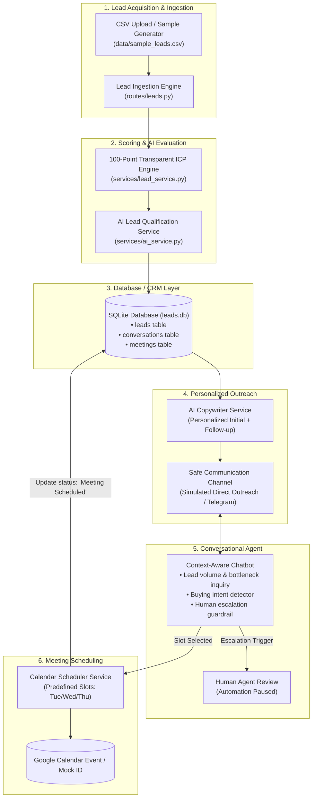

# System Architecture & Component Design

## 1. End-to-End Architecture Diagram

## 2. Component Explanations (Interview-Friendly)

1. **Lead Ingestion Engine**:
   - Parses lead records containing name, role, company, company size, website, requirement, and pain points.
   - Supports both automated sample generation and custom `.csv` uploads.

2. **100-Point Transparent ICP Scoring Engine**:
   - Scores leads algorithmically before LLM invocation to conserve compute:
     - **Industry match**: 25 points
     - **Job title match**: 20 points
     - **Location match**: 15 points
     - **Company size match (10–200 employees)**: 15 points
     - **Business requirement match**: 15 points
     - **Pain point urgency**: 10 points
   - Classifications:
     - **80–100**: Highly Relevant (Qualified)
     - **60–79**: Potential (Nurture)
     - **< 60**: Not Relevant (Disqualified)

3. **AI Lead Qualification Service**:
   - Employs Google Gemini with strict JSON schema constraints.
   - Extracts buying intent (`High`, `Medium`, `Low`), pain points, and recommended next actions.
   - Built-in deterministic fallback ensures 100% demo uptime even without API keys or during network outages.

4. **Personalized Outreach Engine**:
   - Generates hyper-targeted outreach referencing the prospect's actual company name, industry, and exact operational pain points.
   - Creates both initial messages and follow-up touches.

5. **Conversational AI Agent**:
   - Maintains full conversation context stored in SQLite.
   - Asks **one** qualification question at a time to keep response friction low.
   - Includes safety triggers for hostility or requests for a human, immediately pausing automation and notifying the user.

6. **Calendar Scheduling Service**:
   - Offers real available slots (e.g., Wednesday at 3:00 PM).
   - Upon prospect selection, generates calendar event IDs and updates lead status to `Meeting Scheduled`.
